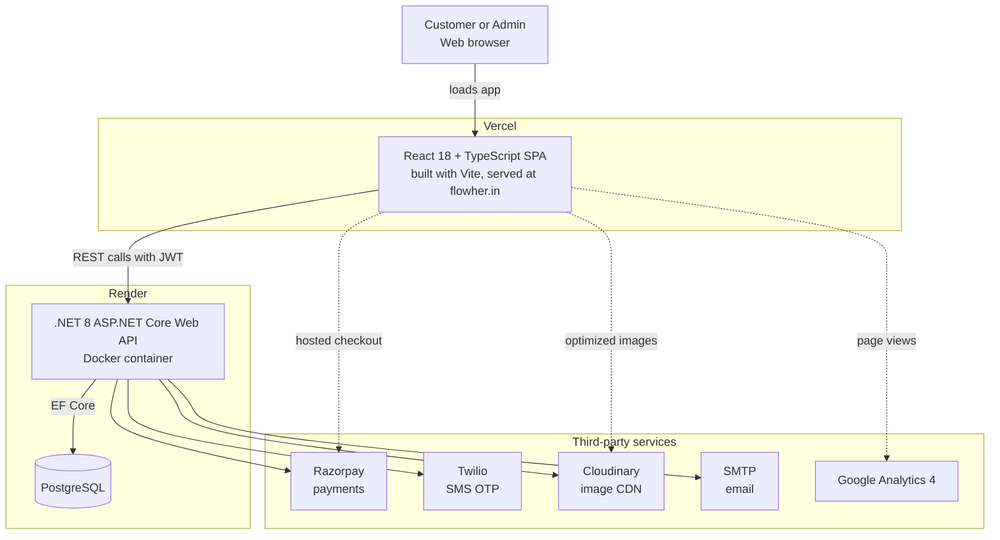
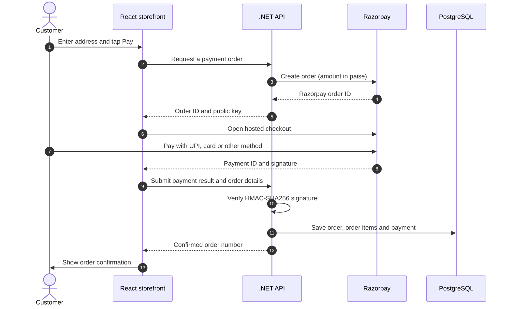
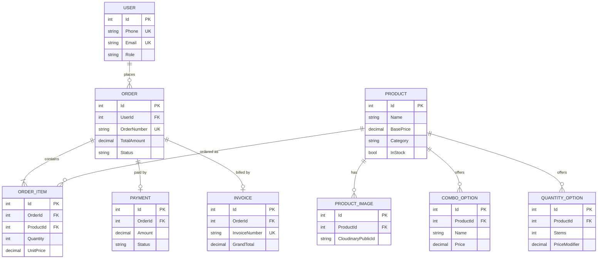

# FlowHer: Case Study of a Live D2C Ecommerce Platform

**Live site:** [flowher.in](https://flowher.in) | **Launched:** January 2026 | **Orders:** 100+

FlowHer is my direct-to-consumer brand for handcrafted paper flowers. Customers browse bouquets by category, choose stem counts and add-ons, sign in with their mobile number, and pay securely online. Behind the storefront, an admin area lets me manage the catalog, move orders through fulfillment and track sales.

This repository is a written case study. It explains what I built, how the system is designed and the product decisions behind it. The production source code is kept private, so no application code is included here.

---

## Contents

1. [My role](#my-role)
2. [What the platform does](#what-the-platform-does)
3. [Tech stack](#tech-stack)
4. [Architecture](#architecture)
5. [Order and payment flow](#order-and-payment-flow)
6. [Data model](#data-model)
7. [Key product decisions](#key-product-decisions)
8. [How I used AI-assisted development](#how-i-used-ai-assisted-development)
9. [Lessons learned](#lessons-learned)
10. [Roadmap: what I would do next](#roadmap-what-i-would-do-next)

---

## My role

**Founder.** I own FlowHer end to end as a business and as a product.

- **Product scope:** decided what the first release needed (catalog, cart, phone login, online payment, order tracking, admin tools) and what could wait.
- **Design:** shaped the storefront look and feel, the product detail experience and the checkout journey.
- **Build:** delivered the platform using AI-assisted development, drawing on my five years as a .NET and C# engineer to steer the backend design and review the output.
- **Marketing and customer research:** ran the launch, gathered customer feedback and used it to decide what to improve next.

## What the platform does

**For customers**
- Browse handcrafted bouquets by category (roses, peonies, daisies, wildflowers, mixed).
- Open a product, pick the number of stems and optional add-ons, and add it to the cart.
- Sign in with an Indian mobile number and a one-time SMS code. No password to remember.
- Enter a delivery address, add an optional gift note and pay through Razorpay (UPI, cards and more).
- View past orders and their status on a "My Orders" page.

**For the business (admin area)**
- Create and edit products, upload product photos and manage stem and add-on options.
- Move each order through a clear lifecycle: pending, processing, packed, shipped, delivered (or cancelled).
- Automatically email customers a review request when an order is marked delivered.
- See a sales dashboard with revenue trends, average order value, order status counts and top products.

## Tech stack

| Layer | Technology | Purpose |
|---|---|---|
| Frontend | React 18, TypeScript, Vite | Single-page storefront and admin UI |
| Styling | Tailwind CSS | Utility-first styling with a custom brand palette |
| Client state and routing | Zustand, React Router, React Context | Cart state, page routing, customer and admin sessions |
| Frontend hosting | Vercel | Static hosting with SPA rewrites for flowher.in |
| Backend | .NET 8, ASP.NET Core Web API (C#) | REST API organized as controllers, services, DTOs and models |
| Backend hosting | Docker on Render | Multi-stage Docker image deployed as a web service |
| Database | PostgreSQL with Entity Framework Core 8 | Relational data for users, products, orders, payments and invoices (SQLite for zero-setup local development) |
| Authentication | Phone OTP via Twilio SMS, JWT bearer tokens | Passwordless customer login, role-based admin access, BCrypt-hashed admin password |
| Payments | Razorpay | Hosted checkout with server-side HMAC-SHA256 signature verification |
| Media | Cloudinary | Product image storage and CDN delivery |
| Email | SMTP | Transactional emails such as delivery and review requests |
| Analytics | Google Analytics 4 | Page views and storefront behavior |

## Architecture

FlowHer uses a classic three-tier design. The React app handles presentation, the .NET API holds the business rules, and PostgreSQL stores the data. Only the API talks to the database or holds credentials for third-party services.

**How a request travels**
1. The browser downloads the built React app from Vercel.
2. React calls the API over HTTPS. Signed-in requests carry a JWT in the Authorization header.
3. ASP.NET Core applies CORS rules, validates the token and routes the request to a controller.
4. Controllers use EF Core for data access and call service classes (behind interfaces) for SMS, images, email and invoices.
5. The API returns JSON and React updates the screen.

A PNG version of each diagram is in [`docs/`](docs/).

## Order and payment flow

The browser never decides that an order is paid. Razorpay returns a signed result, and the API verifies that signature with a secret only the server holds before any order is saved.

Card and UPI details are entered only inside Razorpay's hosted checkout, so they never touch FlowHer's servers.

## Data model

A simplified view of the main entities (key fields only).

**Design notes**
- **Price snapshot on order items.** Each order item stores the unit price at the time of purchase, so order history stays accurate if a product's price changes later.
- **Unique business keys.** Order numbers, invoice numbers, phone numbers and emails have unique constraints.
- **Images stored as IDs, not URLs.** Only the Cloudinary public ID is saved, so image sizes and crops can change later without a data migration.
- **GST-ready invoices.** The invoice entity holds the tax breakdown needed for Indian GST invoicing.

## Key product decisions

| Decision | Why | Trade-off |
|---|---|---|
| Phone OTP login instead of passwords | Natural for Indian shoppers and removes password friction at checkout | Per-message SMS cost and reliance on SMS delivery |
| Razorpay hosted checkout | Supports UPI and cards that Indian customers expect, and keeps payment data off my servers | Order confirmation depends on a browser callback (see roadmap) |
| Separate SPA and API | Frontend and backend deploy independently, and the storefront is cheap to host as static files | Two deployments and CORS configuration to manage |
| .NET 8 for the backend | My strongest stack from five years of professional C# work, with strong typing and a mature security model | Smaller hosting ecosystem than Node for hobby-scale apps |
| Stem counts and add-ons as product options | Mirrors how customers actually buy bouquets and lets one product cover several price points | More complex cart pricing logic |
| Free shipping launch offer | Lowered the barrier for first-time buyers during launch | Shipping cost absorbed by the business |
| Order lifecycle with automatic review emails | Gives customers clear status updates and builds social proof after delivery | Requires reliable email delivery |
| SQLite locally, PostgreSQL in production | Zero setup to start development, production-grade database when live | Small behavioral differences between engines |

## How I used AI-assisted development

As a solo founder, I used AI-assisted development to move from idea to a live store quickly.

- **Where it helped:** scaffolding UI components, API controllers and boilerplate, and speeding up repetitive work across the React and .NET layers.
- **What I owned:** product requirements and scope, the user experience, the choice of services (Razorpay, Twilio, Cloudinary), how the data is structured and what the business needed at each stage.
- **How I kept quality in check:** reviewed generated code with my .NET background, tested the customer and admin journeys before release and iterated based on real customer orders and feedback.

## Lessons learned

- **Payments need a server-side source of truth.** Verifying the payment signature on the server was the right call from day one. The next step is making the server the single authority for prices and payment confirmation.
- **Choose the boring, familiar stack for the risky part.** Using .NET, where I have years of experience, let me reason confidently about authentication, data access and payments.
- **Ship the smallest useful version, then listen.** Launching with a focused feature set and learning from real orders was more valuable than building every feature up front.
- **AI accelerates building, not judgment.** It made a solo build realistic, but decisions about scope, data and trust still had to be mine.
- **Plan for schema change early.** Moving to versioned database migrations sooner makes later changes safer.

## Roadmap: what I would do next

- **Server-side price and coupon validation** so totals are always recomputed from catalog data.
- **Payment webhooks** as a safety net, so an order is recorded even if the customer closes the browser right after paying.
- **Order confirmation and invoice emails** sent automatically after payment.
- **CI pipeline and automated tests** covering checkout, authentication and order management.
- **Secrets management** through the hosting platform's environment configuration, with regular key rotation.
- **Security hardening pass** including rate limiting on login and a review of role-based access across all endpoints.
- **EF Core migrations** instead of create-on-startup for safer schema evolution.
- **Persistent cart** so a page refresh keeps the customer's selections.
- **Background job queue** for email and other slow work.

---

**See it live:** [https://flowher.in](https://flowher.in)

**Contact:** Naina Mehta, officialnainamehta@gmail.com, linkedin.com/in/nainamehta-blr
